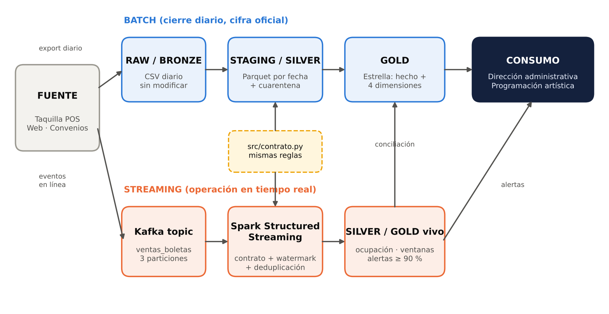

# Proyecto integrador — Gestión de venta de boletas de un teatro

Ingeniería de Datos · Universidad Católica de Colombia · Facultad de Ingeniería
Docente: Diana Marcela Toquica

Pipeline de datos de extremo a extremo para la venta de boletas de un teatro:
desde el archivo crudo de taquilla hasta indicadores para la dirección, en
**dos modos**: batch distribuido con **PySpark** (cifra oficial) y **streaming**
con **Apache Kafka + Spark Structured Streaming** (operación en tiempo real).



## Problema y objetivo

El teatro vende boletas por taquilla, plataforma en línea y convenios. Los
datos llegan con duplicados, fechas en dos formatos, nombres de obra
inconsistentes y canales vacíos, y solo se analizaban al cierre. **Objetivo:**
construir un pipeline confiable que limpie y modele las ventas, responda las
preguntas de ingresos, ocupación, canal y tipo de entrada, y alerte en tiempo
real cuando una función está por llenarse.

Consumidor: dirección administrativa y programación artística (precios,
temporada, presupuesto, apertura de funciones).

## Estructura

```
data/
  raw/ventas_boletas_raw.csv        archivo original, nunca se modifica
  reference/catalogo_funciones.csv  15 funciones, sala y aforo
  staging/ventas_boletas/           SILVER batch (Parquet particionado por fecha)
  quarantine/                       registros que fallan el contrato + duplicados
  gold/                             modelo estrella + indicadores (Parquet y csv/)
  stream/                           entrada, silver, gold y checkpoints del streaming
docs/
  contrato_datos.md                 reglas verificables (v3: batch + evento)
  diccionario_datos.md              significado de cada campo
  mapa_viaje_dato.md                fuente -> raw -> staging -> gold (+ ruta en vivo)
  arquitectura_streaming.md         diseño y resultados del streaming
src/
  comun.py                          rutas, catálogos y SparkSession
  contrato.py                       reglas del contrato (compartidas batch/streaming)
  perfilamiento.py                  diagnóstico de calidad del RAW (Python puro)
  pipeline_batch_spark.py           RAW -> STAGING -> GOLD con PySpark
  comparacion_pandas_pyspark.py     mismo indicador en Pandas y PySpark (x1, x100, x1000)
  productor_eventos.py              simulador de taquilla/web -> archivos o Kafka
  streaming_ventas.py               consumidor Spark Structured Streaming
  graficas.py                       figuras del informe
tests/
  test_contrato.py                  16 pruebas automáticas (contrato + salidas)
evidencia/
  logs_calidad/                     log del batch, plan físico, comparación
  logs_streaming/                   métricas por micro-lote, alertas, conciliación
  figuras/                          gráficas usadas en el informe
docker-compose.yml                  Kafka (KRaft) + creación del tópico
demo_streaming.sh                   demo completa del streaming
```

## Cómo ejecutar

Requisitos: Python 3.10+, Java 17 y `pip install -r requirements.txt`.

```bash
python3 src/perfilamiento.py              # 1. diagnóstico del RAW
python3 src/pipeline_batch_spark.py       # 2. batch: STAGING + GOLD + log de calidad
python3 src/comparacion_pandas_pyspark.py # 3. Pandas vs. PySpark
bash demo_streaming.sh                    # 4. streaming con fuente de archivos
python3 src/graficas.py                   # 5. figuras
python3 -m pytest tests/ -v               # 6. pruebas automáticas
```

Streaming con Kafka (requiere Docker):

```bash
docker compose up -d
python3 src/streaming_ventas.py --fuente kafka --reiniciar    # terminal 1
python3 src/productor_eventos.py --destino kafka --pausa 3    # terminal 2
```

## Resultados principales

| Indicador | Valor |
|---|---|
| Registros RAW | 1.222 |
| Duplicados descartados / cuarentena / STAGING | 8 / 20 / 1.194 |
| Ingreso total validado | $32.855.000 COP |
| Obra con más ingreso | La Celestina — $8,56 M (26 %) |
| Canal con más volumen | En línea — 536 boletas (44,9 %) |
| Funciones ≥ 90 % de ocupación | F4 Bodas de Sangre (96,7 %), F14 La Celestina (92,0 %) |
| Latencia streaming (p95) | 1,9 s |
| Streaming vs. batch | 1.189 vs. 1.194 — 5 eventos muy tardíos, 100 % explicados |

## Integrantes

| Integrante | Código | Responsabilidad principal |
|---|---|---|
| Daniel Felipe Alonso Gómez | 67001466 | Viaje del dato, contrato, modelo y arquitectura |
| Juan Carlos Rodríguez Sánchez | 67001445 | RAW, perfilamiento, pipelines y evidencia |

Informe completo: `Proyecto Ing_Datos.docx`. Manual técnico final: `Manual_Tecnico_Pipeline_Teatro.pdf`.
Repositorio: https://github.com/Alonso-dfg/proyecto-teatro-ingdatos
