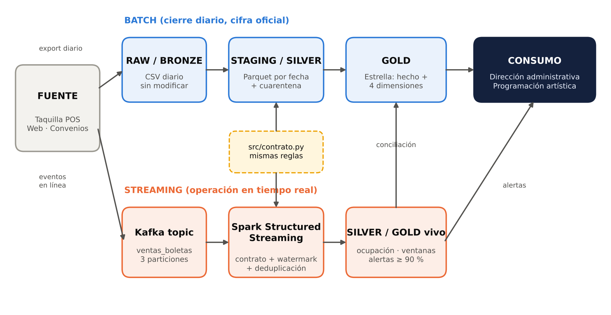

# Arquitectura de streaming — venta de boletas en tiempo real



## Por qué streaming en un teatro

El batch responde "¿cómo nos fue ayer?". La taquilla necesita además saber
**ahora** cuántas boletas quedan para la función de esta noche, si una función
está a punto de llenarse y si un canal dejó de vender. Esas decisiones pierden
valor con cada hora de retraso. Por eso el proyecto combina:

| | Batch (`pipeline_batch_spark.py`) | Streaming (`streaming_ventas.py`) |
|---|---|---|
| Entrada | CSV diario delimitado | Eventos continuos (Kafka o carpeta) |
| Latencia | Horas (cierre diario) | ~1–2 s (p95 medido 1,9 s) |
| Uso | Cifra oficial, informes, presupuesto | Operación: aforo, alertas, ritmo de venta |
| Eventos tardíos | Todos incluidos | Hasta 1 día (watermark); el resto lo recupera el batch |

## Componentes

1. **Productor** (`src/productor_eventos.py`): simula el POS y la web. Cada
   boleta es un evento JSON con `evento_ts` (hora de venta) y `producido_ts`
   (hora de emisión). Publica en Kafka con llave `id_funcion` o en archivos.
2. **Kafka** (`docker-compose.yml`): tópico `ventas_boletas`, 3 particiones.
   Desacopla productores y consumidores y retiene 7 días para reprocesar.
3. **Spark Structured Streaming** (`src/streaming_ventas.py`): 3 consultas.

| Consulta | Operación | Modo de salida | Estado |
|---|---|---|---|
| `silver` | contrato + watermark + `dropDuplicatesWithinWatermark(id_venta)` | append (foreachBatch idempotente por `_batch_id`) | ids vistos en el último día |
| `gold_ocupacion` | `groupBy(id_funcion)` + aforo + alertas | complete | 15 funciones (acotado) |
| `gold_ventanas` | `groupBy(window(evento_ts, 1 día), canal)` | update | ventanas abiertas (el watermark las cierra) |

## Garantías

- **Checkpoints** por consulta en `data/stream/_checkpoints/`: al reiniciar
  se continúa desde el último offset confirmado.
- **Idempotencia**: silver se escribe con sobrescritura dinámica de la
  partición `_batch_id`; repetir un micro-lote no duplica filas.
- **Conciliación**: al terminar se compara con STAGING del batch
  (`evidencia/logs_streaming/resumen_streaming.json`).

## Resultados medidos (ejecución estable, 1 lote cada 3 s)

- 1.222 eventos, 44 micro-lotes con datos, 0 duplicados en silver.
- 20 eventos a cuarentena (mismas reglas que el batch).
- 1.189 boletas en streaming vs. 1.194 en batch: las 5 de diferencia son
  exactamente eventos muy tardíos (4–6 días) descartados por el watermark
  ($125.000 COP que recupera el batch).
- Latencia promedio 1,4 s, p95 1,9 s. Con un lote cada 1,5 s el consumidor
  se saturó y la latencia creció hasta 25 s (`escenario_saturado/`).
- Alertas: F4 Bodas de Sangre (95,3 %) y F14 La Celestina (92,0 %).

## Cómo ejecutar con Kafka

```bash
docker compose up -d
pip install kafka-python-ng
python3 src/streaming_ventas.py --fuente kafka --reiniciar     # terminal 1
python3 src/productor_eventos.py --destino kafka --pausa 3     # terminal 2
```

Spark descarga el conector `org.apache.spark:spark-sql-kafka-0-10_2.12:3.5.3`
la primera vez (requiere internet). La lógica de las consultas es idéntica a la
de la fuente de archivos; solo cambia `leer_fuente()`.
